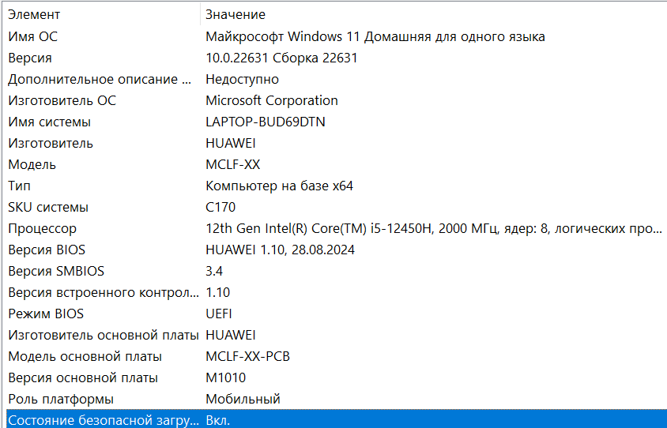
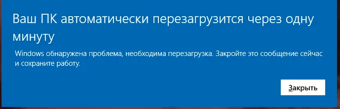

# Как запустить Ancient

<figure><figcaption></figcaption></figure>

**МОЙ FUNPAY** - [https://funpay.com/users/4526933/](https://funpay.com/users/4526933/)

**МОЙ FUNPAY** - [https://funpay.com/users/4526933/](https://funpay.com/users/4526933/)

**МОЙ FUNPAY** - [https://funpay.com/users/4526933/](https://funpay.com/users/4526933/)

***

## 1. Установка нужных библиотек и архиватора

1. **.NET Framework**

* Установите последнюю версию - [ссылка](https://drive.google.com/file/d/1rNkK5EjYN94Zv1Lz82CjJ_ovA15r42mY/view?usp=sharing)
* Запустите приложение и следуйте инструкциям

2. **Visual C++ Redistributable**

* Установите последнюю версию - [ссылка](https://drive.google.com/file/d/1-MAtvixkw43959-WtNi-VQU_weMeZsc-/view?usp=sharing)
* Запустите приложение и следуйте инструкциям

3. **DirectX**

* Установите последнюю версию - [ссылка](https://drive.google.com/file/d/19jF0U9gxYGgPWNBFyVe-dTOA0S-nOEMG/view?usp=sharing)
* Запустите приложение и следуйте инструкциям

4. **WinRAR**&#x20;

* Установите последнюю версию - [ссылка](https://drive.google.com/file/d/10_CpTVkO-4uzPlhhYki8XqnnCVlWVJLA/view?usp=sharing)

***

## 2. Отключение защитника windows

1. **Отключение Безопасность Windows**

* Перейдите в параметры системы (вы можете нажать комбинацию WIN + I)
* Откройте **Безопасность Windows**
* Отключите параметр **"Защита в реальном времени"**

<figure><figcaption></figcaption></figure>

2. Окончательно отключите **Безопасность Windows** с помощью программы **dControl**

* **Google Drive** - [ссылка для загрузки](https://drive.google.com/file/d/19G3C5Gg1KDr1W05jhwwB6xeMx8PG_IrU/view?usp=sharing) (пароль 1234)
* **Yandex Disk** - [ссылка для загрузки](https://disk.yandex.ru/d/pLPzChHbwskWNQ) (пароль 1234)
* **Mega** - [ссылка для загрузки](https://mega.nz/file/Vr9EUSKB#Sn0bze9l49paasaCZqYPkAodQwo5avSpUWVzo5f4x38)

<figure><figcaption>
<strong>Нажмите "</strong><mark style="color:red;"><strong>Отключить Защитник Windows</strong></mark><strong>"</strong> 
</figcaption></figure>


Если ваш браузер блокирует загрузку, решение можно найти [здесь](reshenie-problem-zapuska/brauzer-blokiruet-zagruzku-faila.md)


***

## **3. Удаление конфликтующего программного обеспечения**

Следующие программы необходимо **полностью удалить**, а не просто закрыть:

* **Античит FACEIT**
* Любой сторонний антивирус (Avast, Kaspersky, McAfee, ESET, Bitdefender и т. д.)


Если установлен FACEIT AC или сторонний антивирус, продукт **не будет работать** независимо от других настроек.



**ПОСЛЕ ВСЕХ ДЕЙСТВИЙ ПЕРЕЗАГРУЗИТЕ ПК**


***

## **4. Подготовка системы к запуску продукта**

1. <mark style="color:$danger;">**Удалите PIN-код и пароль для входа в windows**</mark>
2. Выключите: <mark style="color:red;">**Secure Boot**</mark> <mark style="color:red;"></mark><mark style="color:red;">(</mark><mark style="color:red;">**в BIOS**</mark><mark style="color:red;">)</mark> - Можно проверить по следующему пути: Вводим в поиск по **Windows** команду -> "msinfo32" -> **Состояние безопасной загрузки** (Должно быть "**Выключено**")


Если у вас игра COD, Battlefield, Delta Force, Rust то выключать <mark style="color:red;">**Secure Boot**</mark>  не требуется!


<figure><figcaption>
<strong>Подобным выглядит пункт, который требуется Выключить</strong>
</figcaption></figure>

2. Включите: <mark style="color:red;">**VT-X (VT-D)**</mark> <mark style="color:red;"></mark><mark style="color:red;">|</mark> <mark style="color:red;"></mark><mark style="color:red;">**SVM Mode**</mark> <mark style="color:red;"></mark><mark style="color:red;">(AMD CPU) (Виртуализация) (в BIOS)</mark> - Можно проверить включено ли по следующему пути: Диспетчер Задач -> ЦП -> Процессор

<figure><figcaption>
<strong>Виртуализация: Включено</strong>
</figcaption></figure>

3. Если у вас процессор от AMD Выключите: <mark style="color:red;">**HyperV (в системе)**</mark> \
   Если у вас процессор от Intel Включите: <mark style="color:red;">**HyperV (в системе)**</mark>


Если у вас игра Delta Force, Arena Breakout, WARDOGS то нужно обязательно выключить <mark style="color:red;">**HyperV**</mark>**&#x20;независимо от процессора!**



Если у вас игра RUST, то нужно обязательно включить <mark style="color:red;">**HyperV**</mark>**&#x20;независимо от процессора!**


**Включение/Отключение Hyper-V в панели управления**

**₁** В панели управления выберите **Программы и компоненты**.

**₂** Выберите **Включение или отключение компонентов Windows**.

<figure><figcaption></figcaption></figure>


Если опция включения функции "Гипервизор Hyper-V" недоступна (заблокирована), это означает, что в настройках биоса у вас не включена виртуализация.

Если функция "Hyper-V" не отображается, это означает, что компоненты Hyper-V не установлены в вашей системе (скорее всего, потому что у вас установлена ​​Windows Home Edition). В этом случае вы можете следовать этому руководству - ссылка на руководство


4. Выключите: <mark style="color:red;">**TPM (Security Device Support) (в BIOS)**</mark> - Можно проверить по следующему пути: Вводим в поиск по **Windows** команду -> "tpm.msc"&#x20;


Если у вас игра CoD, BF6, Delta Force, ARC Raiders, Rust то выключать <mark style="color:red;">**TPM**</mark>  не требуется!


(Должно быть "**Не удаётся найти совместимый доверенный платформенный модуль**")

<figure><figcaption></figcaption></figure>

**Дополнительно**, если у Вас игра: **Delta Force**, **PUBG**:\
• **GPT disk formate** **-** <mark style="color:red;">Обязателен!</mark>\
• **UEFI BIOS** **-** <mark style="color:red;">Обязателен!</mark>

***

## 5. Установка оверлея для отображения Ancient


Работа проекта "_**Ancient**_" основана на продуктах, типа "**External**", в связи с чем проект использует оверлей Вашей видеокарты для отображения продукта в самой игре.


**Для игр: Apex, Delta Force, ARC Raiders, Rust.&#x20;**<mark style="color:$danger;">**РАБОТАЕТ ТОЛЬКО MEDAL**</mark> \
**Для игры: WARDOGS&#x20;**<mark style="color:$danger;">**РАБОТАЕТ ТОЛЬКО DISCORD**</mark>


FunPay запретил давать ссылки на сторонние сайты, поэтому ссылку дать не смогу


> **SteelSeries** - <mark style="color:green;">поддерживает Полноэкранный режим:</mark>
>
> 1. Зайдите в настройки **SteelSeries**&#x20;
> 2. В разделе **Общие -> Общие** необходимо включить Sonar,&#x20;
> 3. Затем перейдите во вкладку **SONAR -> Горячие клавиши** и поставьте бинд на **Ведущий элемент - Громче** например клавиша **"F7"**,&#x20;
> 4. <mark style="color:red;">**необходимо нажимать этот бинд перед инжектом.**</mark>&#x20;
>
> **Также требуется отключить momets для корректной работы продукта.**
>
> .png>)
>
> **видеоинструкция** - [https://disk.yandex.ru/d/9owhhfrcovuioA](https://disk.yandex.ru/d/9owhhfrcovuioA)

> **NVidia App** - <mark style="color:green;">НЕ поддерживает полноэкранный режим:</mark>
>
> Для использования NVidia app overlay, необходимо открыть настройки, перейти в Generals и <mark style="color:red;">**включить IN-GAME OVERLAY**</mark>

> _**Medal** - <mark style="color:green;">НЕ поддерживает полноэкранный режим:</mark>_\
> _для пользователей из России потребуется VPN. Для использования необходимо скачать оверлей и зарегистрироваться._

> _Discord - <mark style="color:green;">НЕ поддерживает полноэкранный режим:</mark> Для использования необходимо_&#x20;
>
> 1. &#x20;_зайти в настройки в разделе "игровой оверлей" включить оверлей, отключить "устаревший оверлей"._
>
> _\*Если в разделе текущая активность появляется надпись "нет доступных оверлеев" нужно выключить и включить оверлей снова._
>
> 2. _зайти в настройки в разделе "система" включить " включить аппаратное ускорение"_


Меню теперь отображается примерно через 1-2 минуты.

Это сделано из соображений безопасности.


***

## **6. Запуск Ancient**

1. Устанавливаем **LOADER** (**Установщик**) - [ссылка для загрузки](https://undetect.net/download/loader)
2. Запускаем Лоадер <mark style="color:red;">от имени администратора</mark>, вводим полученный ключ, затем нажимаем <mark style="color:red;">"</mark><mark style="color:red;">**LOAD**</mark><mark style="color:red;">"</mark>. В случае, если всё установлено правильно, загрузчик закроется, и Вы можете заходить в игру.

> <mark style="color:blue;">**После того как вы нажали кнопку "LOAD"**</mark> <mark style="color:blue;">**продукт начнёт процесс инжекта, во время него у вас может появится плашка:**</mark><mark style="color:blue;">**&#x20;**</mark>_<mark style="color:blue;">**Ваш ПК автоматически перезагрузится через одну                минуту**</mark>_
>
>
>
> 
>
> <mark style="color:blue;">**Дождитесь перезагрузки и запустите Loader ещё раз, если плашка появляется ещё раз - значит нужно опять дождаться перезагрузки ПК.**</mark>

3. Вот и все, можете спокойно играть! Меню открывается и закрывается на <mark style="color:red;">**"Insert"**</mark>
