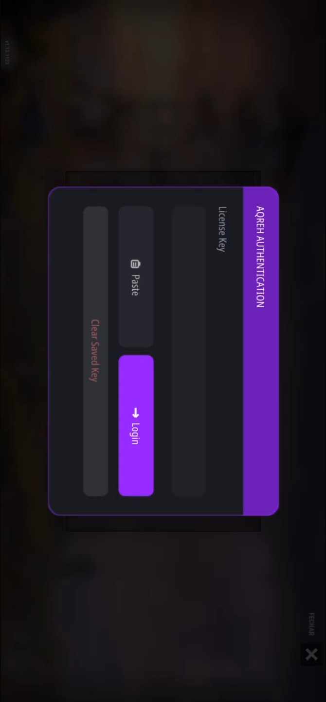

# Как запустить AQREH OXIDE IOS

<figure><figcaption></figcaption></figure>

**МОЙ FUNPAY** - [https://funpay.com/users/4526933/](https://funpay.com/users/4526933/)

**МОЙ FUNPAY** - [https://funpay.com/users/4526933/](https://funpay.com/users/4526933/)

**МОЙ FUNPAY** - [https://funpay.com/users/4526933/](https://funpay.com/users/4526933/)

***

#### Поэтапная текстовая инстуркция по запуску на примере GBox

1. Скачайте файл выданный вам вместе с ключом активации
2. Откройте его

<figure><figcaption></figcaption></figure>

3. Слева снизу нажмите поделиться

<figure><figcaption></figcaption></figure>

4. В списке приложений найдите Гбокс и нажмите на него

<figure><figcaption></figcaption></figure>

5. Вас и файл перекинет в гбокс, там нажмите на файл который вы скачали

<figure><figcaption></figcaption></figure>

6. Появится список возможностей(возможно задержка перед появлением до 1 минуты) нажмите Sign/Подписать (зависит от языка)

<figure><figcaption></figcaption></figure>

7. Откроется настройка подписи, ничего не меняя просто нажми подписать/sign снизу экрана.

<figure><figcaption></figcaption></figure>

8. Давайте разрешения на все запросы и просьбы установить, делать так до появления кнопки "на рабочий стол"
9. Нажать на кнопку "на рабочий стол"

<figure><figcaption></figcaption></figure>

8. Дождитесь установки и запустите Oxide

<figure><figcaption></figcaption></figure>

9. Введите ключ активации который вы получили вместе с файлом

<figure><figcaption></figcaption></figure>

10. Вот и всё готово, можете играть!

<figure><figcaption></figcaption></figure>
