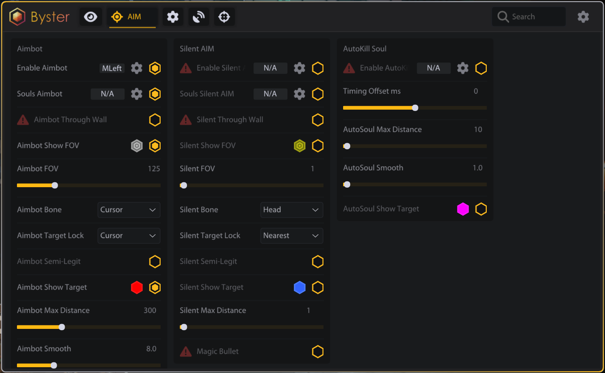

# Deadlock

<figure><figcaption></figcaption></figure>

<figure><figcaption></figcaption></figure>

## ESP

### GENERAL

> Включить ESP\
> Box ESP + Цвет\
> Режим Box (Full / Corner / 3D Box)\
> Полоска здоровья + Цвет\
> Текст HP + Цвет\
> Показать дистанцию + Цвет\
> Показать скелет + Цвет\
> Игнорировать тиммейтов\
> Макс. дистанция (0–1000)\
> Проверка видимости + Цвет

### SOUL ESP

> Показать души + Цвет\
> Макс. дистанция душ (10–500)\
> Показать выпавшие души\
> Дистанция выпавших душ (10–1000)

### HERO ESP

> Имя ESP + Цвет\
> Показать уровень + Цвет\
> Показать имя героя + Цвет\
> Показать инвентарь\
> Масштаб инвентаря (5–25)\
> Показать способности\
> Позиция способностей (Снизу / Сверху / Слева / Справа)\
> Масштаб способностей (5–25)\
> Отображение уровня (Точки / Текст LVL)\
> Размер текста уровня (8–30)\
> Цвет уровня

### MOBS

> Показать нейтралов + Цвет\
> Стиль нейтралов (Квадрат / 3D круг / Ромб)\
> Макс. дистанция нейтралов (0–100)\
> Масштаб нейтралов (0.3–3.0)

## AIM

### AIMBOT

> Включить Aimbot + Клавиша\
> Aimbot на души + Клавиша\
> Aimbot сквозь стены\
> Показать FOV + Цвет\
> FOV (1–500)\
> Кость (Голова / Тело / Шея / Ноги / Случайно / Курсор)\
> Захват цели (Ближайший / Курсор / Авто)\
> Полу-легит\
> Показать цель + Цвет\
> Макс. дистанция (0–1000)\
> Сглаживание (1–30)

### SILENT AIM

> Включить Silent AIM + Клавиша\
> Silent на души + Клавиша\
> Silent сквозь стены\
> Показать FOV + Цвет\
> FOV (1–500)\
> Кость (Голова / Тело / Шея / Ноги / Случайно / Курсор)\
> Захват цели (Ближайший / Курсор / Авто)\
> Полу-легит\
> Показать цель + Цвет\
> Макс. дистанция (0–1000)\
> Magic Bullet

### AUTOKILL SOUL

> Включить AutoKill Soul + Клавиша\
> Смещение тайминга мс (-200–200)\
> Макс. дистанция AutoSoul (10–500)\
> Сглаживание AutoSoul (1–15)\
> Показать цель AutoSoul + Цвет

## MISC

### MISC

> Bunny Hop\
> Идеальная активная перезарядка\
> Идеальный дэшджамп\
> Авто парирование\
> Дистанция парирования (3–15)

### BOSS NOTIFICATION

> Оповещение об атаке босса\
> Позиция X %\
> Позиция Y %\
> Размер текста

## RADAR

### RADAR

> Включить радар\
> Размер радара (100–500)\
> Дальность (30–500)\
> Позиция (Сверху-лево / Сверху-право / Снизу-лево / Снизу-право)\
> Свободное перетаскивание\
> Показать направление взгляда\
> Показать имена героев\
> Размер текста (8–20)\
> Размер игрока (8–40)\
> Прозрачность (50–255)\
> Показать конус FOV

## RECOIL

### RECOIL COMPENSATION

> Включить отдачу + Клавиша\
> Всегда активно\
> Режим (Реактивный / Паттерн)\
> Скорость px/s (1–1000)\
> Множитель x10 (1–30)\
> Макс. отдача px (0–500)\
> Раскрутка мс (0–500)\
> Задержка активации мс (0–500)\
> Затухание мс (0–300)\
> Пресет паттерна (Нет / Линейный / Диагональ-Л / Диагональ-П / S-Кривая)
