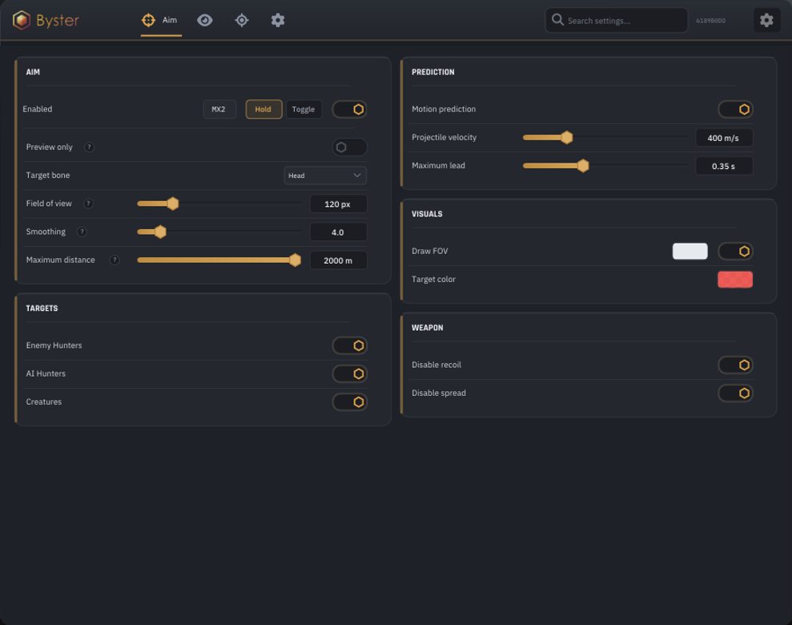
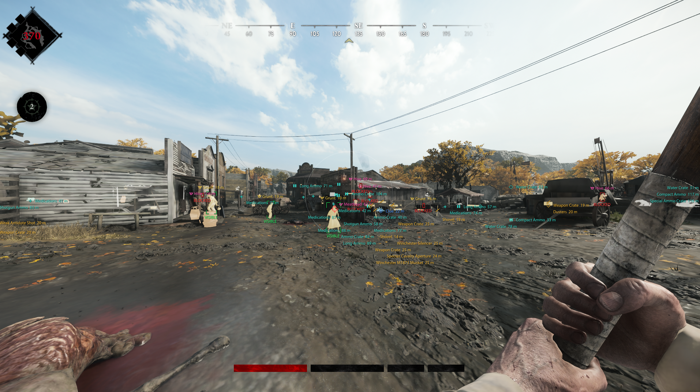

# Hunt: Showdown

<figure><figcaption></figcaption></figure>

<figure><figcaption></figcaption></figure>

## AIM

### AIM

> Включить AIM\
> Только предпросмотр\
> Наводиться на вражеских охотников\
> Наводиться на ботов-охотников\
> Наводиться на монстров\
> Точка наведения: Голова / Грудь / Таз / Ближайшая к прицелу\
> FOV наведения\
> Плавность AIM\
> Максимальная дистанция наведения\
> Показывать FOV\
> Цвет FOV

### ПРЕДИКТ СНАРЯДОВ

> Включить предикт движения\
> Скорость снаряда\
> Максимальное время предикта

### МОДИФИКАЦИИ ОРУЖИЯ

> Без отдачи\
> Без разброса

## ESP

### ОБЩИЕ НАСТРОЙКИ ESP

> Включить ESP\
> Скрывать союзников\
> Показывать номер группы в метках\
> Максимальное количество элементов на экране\
> Максимальная дистанция ESP

### ОБЩИЕ НАСТРОЙКИ ПОДСВЕТКИ

> Включить подсветку\
> Общая яркость подсветки

### ОХОТНИКИ

> Вражеские охотники\
> Союзные охотники\
> Боты-охотники\
> Цвет ESP\
> Цвет подсветки\
> Рамка: Угловая / Полная\
> Скелет\
> Расстояние\
> Максимальная дистанция ESP\
> Всегда показывать подсветку\
> Максимальная дистанция подсветки\
> Яркость подсветки

### МОНСТРЫ

> Дикие цели\
> Гранты\
> Помеченные монстры\
> Группы монстров\
> Сезонные монстры\
> Мёртвые сущности\
> Цвет ESP\
> Цвет подсветки\
> Рамка: Угловая / Полная\
> Скелет\
> Расстояние\
> Максимальная дистанция ESP\
> Всегда показывать подсветку\
> Максимальная дистанция подсветки\
> Яркость подсветки

### БОСС

> ESP босса\
> Подсветка босса\
> Цвет ESP\
> Цвет подсветки\
> Рамка: Угловая / Полная\
> Скелет\
> Расстояние\
> Максимальная дистанция ESP\
> Всегда показывать подсветку\
> Максимальная дистанция подсветки\
> Яркость подсветки

### ПРЕДМЕТЫ И ОБЪЕКТЫ

> Цели задания\
> Точки эвакуации\
> Припасы\
> Оружие и снаряжение\
> Награды и черты\
> Ловушки и опасные объекты\
> Снаряды\
> Шумовые ловушки\
> Цвет ESP\
> Цвет подсветки\
> Рамка: Угловая / Полная\
> Расстояние\
> Максимальная дистанция ESP\
> Всегда показывать подсветку\
> Максимальная дистанция подсветки\
> Яркость подсветки

## РАДАР

### РАДАР

> Включить радар\
> Конус обзора\
> Размер радара\
> Дальность радара\
> Прозрачность радара\
> Положение: Сверху слева / Сверху справа / Снизу слева / Снизу справа

## РАЗНОЕ

### КАМЕРА

> Включить изменение FOV\
> FOV камеры

### БОЕВОЙ РЕЖИМ

> Включить боевой режим\
> Клавиша боевого режима\
> Показывать только живых врагов и враждебных монстров
