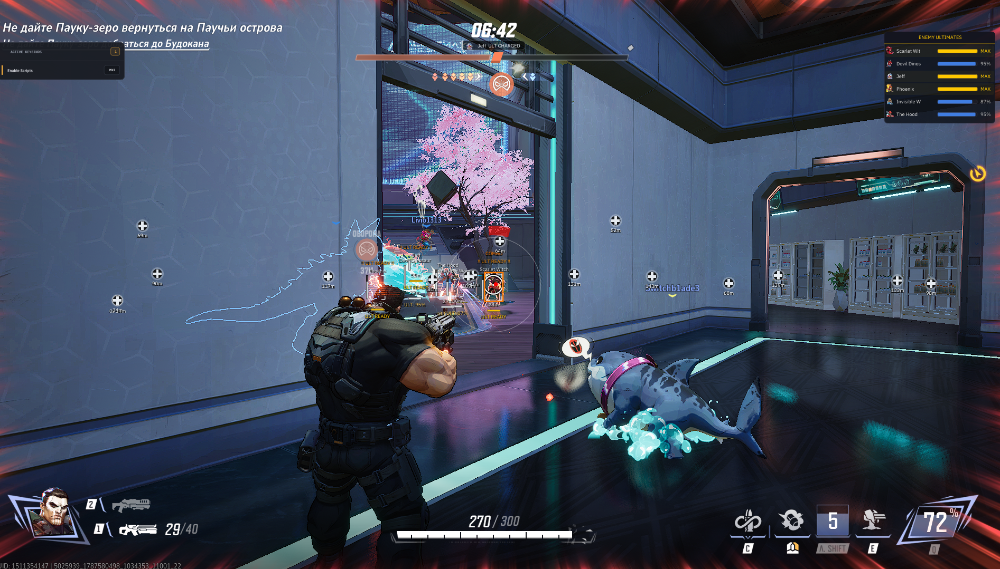
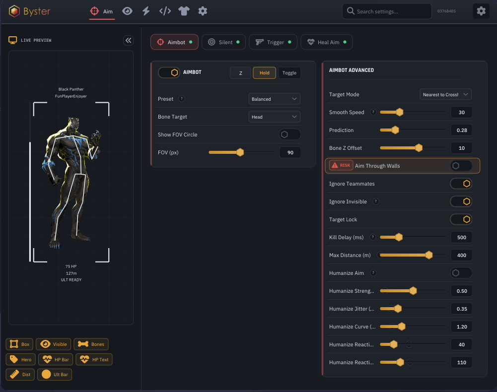

# Marvel Rivals

<figure><figcaption></figcaption></figure>

<figure><figcaption></figcaption></figure>

## АИМ

### АИМБОТ

> Включить\
> Бинд аима\
> Пресет Legit\
> Пресет Balanced\
> Пресет Rage\
> Аим в голову\
> Аим в тело\
> Аим в руки\
> Аим в ноги\
> Ближайшая к прицелу цель\
> Ближайшая по дистанции цель\
> Цель с наименьшим HP\
> Плавность аима\
> FOV аима\
> FOV-круг аима\
> Предикт движения\
> Предикт баллистики снарядов\
> Авто-определение скорости снаряда\
> Авто-определение гравитации снаряда\
> Смещение точки наведения по высоте\
> Выбор цели сквозь стены\
> Игнорировать тиммейтов\
> Игнорировать невидимых\
> Лок цели\
> Задержка после килла\
> Дистанция аима\
> Хьюманизация аима\
> Сила хьюманизации\
> Джиттер прицела\
> Криволинейное наведение\
> Имитация времени реакции

### САЙЛЕНТ АИМ

> Включить\
> Бинд сайлент аима\
> Сайлент пренаправление\
> Сайлент пакетный\
> Сайлент в голову\
> Сайлент в тело\
> Сайлент в руки\
> Сайлент в ноги\
> FOV сайлент аима\
> FOV-круг сайлент аима\
> Режим FOV Limited\
> Режим On Screen\
> Режим Unlimited\
> Ближайшая к прицелу цель\
> Ближайшая по дистанции цель\
> Цель с наименьшим HP\
> Задержка переключения цели\
> Предикт движения\
> Выбор цели сквозь стены\
> Кап дистанции хита для снарядов\
> Шанс попадания (Hit Chance)\
> Диапазон шанса попадания

### ТРИГГЕР БОТ

> Включить\
> Бинд триггер бота\
> Выстрел через функцию игры\
> Эмуляция ЛКМ\
> Автоматический fallback на ЛКМ\
> Задержка выстрела\
> Игнорировать невидимых

### ХИЛ АИМ

> Включить\
> Бинд хил аима\
> Наведение на союзников\
> Хил в голову\
> Хил в тело\
> Ближайший к прицелу союзник\
> Ближайший по дистанции союзник\
> Союзник с наименьшим HP\
> FOV хил аима\
> Плавность наведения\
> Смещение точки наведения по высоте\
> Лок цели\
> Задержка переключения союзника\
> Хил при полном HP\
> Оверхил и пополнение щитов\
> Порог полного HP\
> Дистанция хил аима

### САЙЛЕНТ ХИЛ

> Включить\
> Бинд сайлент хила\
> Скрытный хил союзников\
> Хил в голову\
> Хил в тело\
> Ближайший к прицелу союзник\
> Ближайший по дистанции союзник\
> Союзник с наименьшим HP\
> FOV сайлент хила\
> Предикт движения союзников\
> Хил при полном HP\
> Порог полного HP\
> Дистанция сайлент хила

## ESP

### ИГРОКИ

> Включить\
> ESP врагов\
> ESP тиммейтов\
> Полный бокс\
> Угловой бокс\
> Проверка видимости\
> Смена цвета при видимости\
> Скелет\
> Линии до игроков\
> Дальность ESP игроков\
> Цвета ESP игроков

### ИНФОРМАЦИЯ

> Имя героя\
> Ник игрока\
> Полоса HP\
> HP текстом\
> Дистанция\
> Полоса заряда ульты\
> Индикатор готовности ульты\
> Отображение невидимых врагов\
> Тег \[INVIS] на невидимых\
> Режим «только видимые»\
> Счётчик FPS\
> Цвета элементов

### РАСПОЛОЖЕНИЕ

> Редактор расположения элементов\
> Панель предпросмотра ESP\
> Перетаскивание элементов мышью\
> Отступы между элементами\
> Смещение полосы HP\
> Ширина полосы ульты\
> Высота полосы ульты

### ОБЪЕКТЫ

> ESP хилпаков\
> Дистанция до хилпаков\
> Таймер возрождения хилпаков\
> ESP порталов\
> Дистанция до порталов\
> Цвета объектов

### УЛЬТИМЕЙТЫ

> Уведомления о зарядке ульт\
> Уведомления об использовании ульт\
> Позиция уведомлений\
> Длительность уведомлений\
> Цвет уведомлений\
> Панель ультов врагов\
> Заряд ульты каждого врага\
> Позиция панели\
> Ширина панели

## РАЗНОЕ

### ЭКСПЛОЙТЫ

> Server Anchor (фейк-лаги)\
> Бинд Server Anchor\
> Визуализация точки якоря\
> Визуализация зоны регистрации урона\
> Teleport Lag (фейк-пинг)\
> Бинд Teleport Lag\
> Интервал Teleport Lag\
> Target Freeze\
> Заморозка цели при зажатом аиме\
> Back-track\
> Попадание по последней видимой позиции\
> Длительность Back-track\
> FOV Back-track\
> Отмена Back-track при дрейфе

### КАМЕРА

> Изменение FOV\
> Значение FOV

### СКРИПТЫ

> Движок авто-комбо за героев\
> Мастер-переключатель скриптов\
> Бинды способностей\
> Оверлей активных биндов\
> Авто-комбо Black Panther\
> Иконки героев в меню

### СКИН ЧЕНДЖЕР

> Включить\
> База из 638 скинов\
> Скины по героям\
> Редкости скинов\
> Иконки скинов\
> Поиск героя по имени

### ОСНОВНОЕ

> Система конфигов\
> Автосохранение настроек\
> Safe Mode\
> Русская локализация\
> Английская локализация\
> Масштабирование интерфейса\
> Выгрузка софта биндом
