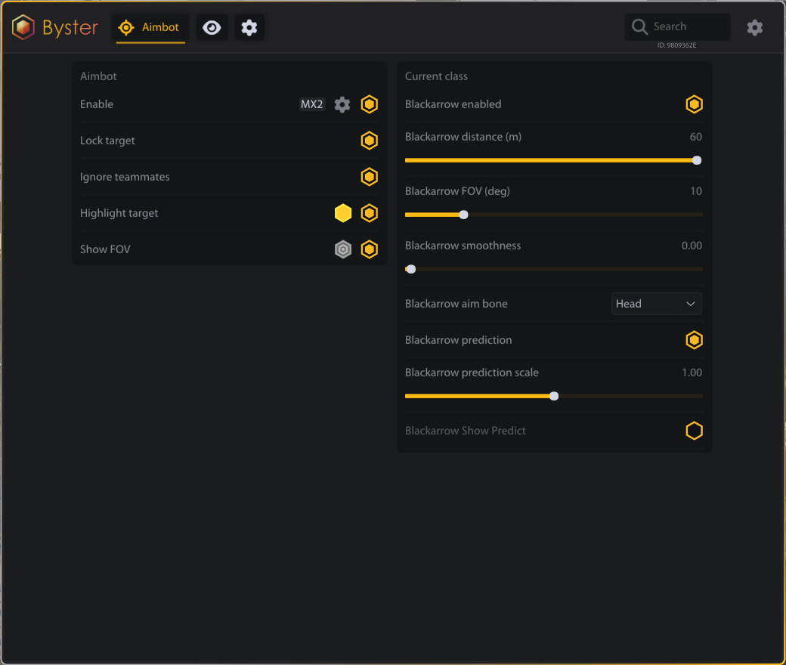
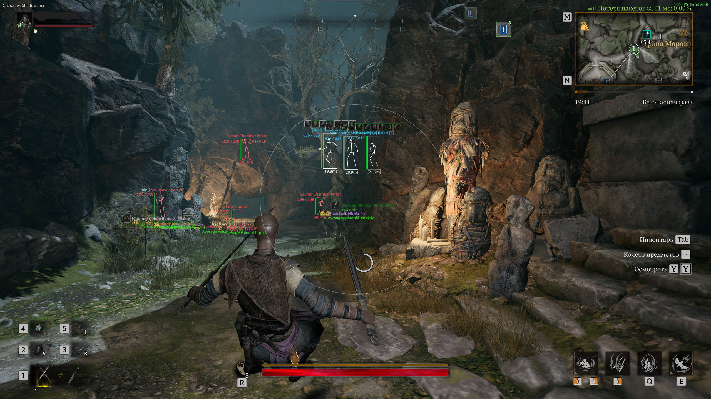

# Mistfall Hunt

<figure><figcaption></figcaption></figure>

<figure><figcaption></figcaption></figure>

## АИМ

### АИМБОТ

> Включить\
> Бинд аима\
> Лок цели\
> Игнорировать тиммейтов\
> Подсветка цели\
> Цвет подсветки цели\
> FOV-круг аима\
> Цвет FOV-круга\
> Аим в голову\
> Аим в тело\
> Аим в ближайшую кость\
> Плавность аима\
> Дистанция аима\
> FOV аима\
> Предикт под оружие\
> Множитель предикта\
> Фильтр предикта при стрейфе\
> Фильтр предикта при прыжке\
> Профиль Mercenary\
> Профиль Sorcerer\
> Профиль Blackarrow\
> Профиль Shadowstrix\
> Профиль Seer\
> Профиль Withered Knight\
> Определение локального персонажа\
> Индикатор локального персонажа

## ESP

### ИГРОКИ

> Включить\
> ESP ботов\
> Имя\
> Класс\
> ID команды\
> Дистанция\
> Полный бокс\
> Угловой бокс\
> Полоса HP\
> Скелет\
> Мёртвые игроки\
> Скрывать тиммейтов\
> Иконки брони\
> Рамки редкости брони\
> Размер иконок брони\
> Прозрачность иконок брони\
> Цвета ESP игроков\
> Подсветка бокса цели\
> Подсветка скелета цели\
> Дальность ESP игроков

### МОБЫ

> Включить\
> Локализованные названия мобов\
> Дистанция\
> Полный бокс\
> Угловой бокс\
> Полоса HP\
> Скелет\
> Мёртвые мобы\
> Боссы\
> Элита\
> Мини-боссы\
> Предупреждение об атаке\
> Обнаружение Hermit Sprites\
> Цвет Hermit Sprites\
> Цвета ESP мобов\
> Подсветка бокса цели\
> Подсветка скелета цели\
> Дальность ESP мобов

### ЛУТ

> Включить\
> Локализованные названия предметов\
> Обнаружение лутаемых контейнеров\
> Иконки предметов\
> Размер иконок предметов\
> Прозрачность иконок предметов\
> Количество предметов\
> Дистанция до предметов\
> Редкость предметов\
> Стоимость предмета\
> Стоимость стака\
> Цвет стоимости\
> Фильтры редкости\
> Цвета редкости\
> Фильтр Damaged\
> Фильтр Common\
> Фильтр Rare\
> Фильтр Excellent\
> Фильтр Epic\
> Фильтр Legendary\
> Фильтр Holy\
> Фильтр Prismatic\
> Дальность ESP лута

### СОКРОВИЩА

> Включить\
> Локализованные названия сокровищ\
> Иконки сокровищ\
> Размер иконок сокровищ\
> Прозрачность иконок сокровищ\
> Дистанция до сокровищ\
> Скрывать открытые сокровища\
> Цвет открытых сокровищ\
> Обнаружение сундуков с ключом\
> Префикс закрытого сундука\
> Средняя стоимость сокровища\
> Цвет средней стоимости\
> Фильтр сундуков\
> Фильтр залежей руды\
> Фильтр природных объектов\
> Фильтр контейнеров\
> Фильтр снаряжения\
> Фильтр ритуалов\
> Фильтр кузниц\
> Фильтр кораблекрушений\
> Фильтр The Exiled\
> Фильтр прочих сокровищ\
> Цвета категорий сокровищ\
> Дальность ESP сокровищ

### СПОСОБНОСТИ

> Включить\
> Названия способностей\
> Иконки способностей\
> Кулдауны способностей\
> Неизвестный статус кулдауна\
> Фильтр боевых навыков\
> Отображение списком\
> Отображение панелью\
> Цвет готовой способности\
> Цвет способности на кулдауне\
> Фон способностей\
> Цвет фона способностей\
> Размер иконок способностей\
> Фильтр способностей тиммейтов\
> Дальность способностей 25 метров

### ОБЪЕКТЫ

> Включить\
> Обнаружение DoomTrap\
> Маркер DoomTrap\
> Цвет DoomTrap\
> Дистанция до объектов\
> Дальность ESP объектов

## РАЗНОЕ

### ОСНОВНОЕ

> Изменение FOV\
> Боевой режим\
> Бинд боевого режима\
> Скрывать предметы в боевом режиме\
> Скрывать сокровища в боевом режиме\
> Скрывать мёртвых персонажей в боевом режиме\
> VSync\
> Лимит FPS\
> Счётчик FPS\
> Индикатор частоты обновления\
> Размер текста ESP\
> Автоматическая английская локализация\
> Автоматическая русская локализация\
> Автоматическая китайская локализация\
> Встроенные иконки\
> Встроенные данные локализации\
> Автоматическое обнаружение игры\
> Автоматическое обнаружение окна игры\
> Отслеживание окна оверлеем\
> Сквозные клики через оверлей
