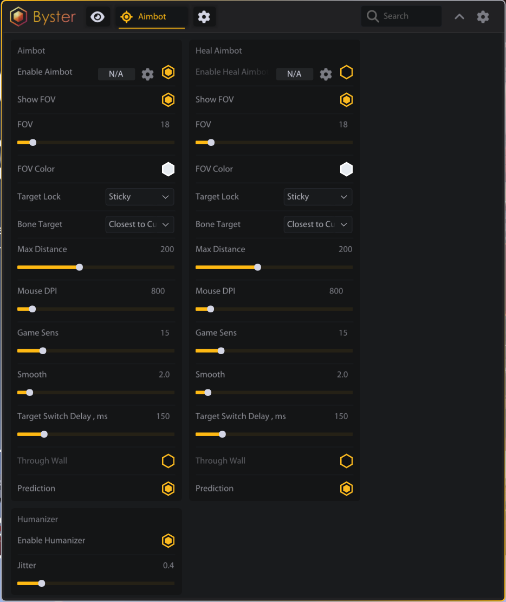
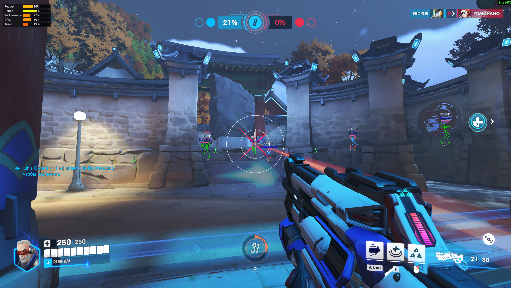

# Overwatch

<figure><figcaption></figcaption></figure>

<figure><figcaption></figcaption></figure>

## ESP

### ESP

> Рамка (Полная / Углы / Выкл.)\
> Режим рамки\
> Цвет рамки\
> Скелет\
> Цвет скелета\
> Полоска HP\
> Позиция полоски HP\
> Цвет полоски HP\
> Текст HP\
> Позиция текста HP\
> Цвет текста HP\
> Дистанция\
> Позиция дистанции\
> Цвет дистанции\
> Имя героя\
> Позиция имени героя\
> Цвет имени героя\
> Проверка видимости\
> Цвет видимых\
> Макс. дистанция\
> Показывать сегменты щита\
> Цвет брони\
> Цвет барьера\
> Процент ульты\
> Масштаб текста ульты\
> Позиция текста ульты\
> Скрывать союзников\
> Показывать турели\
> Скрывать невидимых героев\
> Всегда скрывать неуязвимых\
> Предпросмотр ESP\
> Активные бинды

## AIMBOT

### AIMBOT

> Включить (с биндом)\
> Показать FOV\
> FOV\
> Цвет FOV\
> Захват цели (Ближайший / Курсор / Авто / Залипание)\
> Кость (Голова / Тело / Ноги / Ближайшая к курсору)\
> Макс. дистанция\
> DPI мыши / Сенса\
> Плавность\
> Задержка смены цели (мс)\
> Стрельба сквозь стены\
> Упреждение\
> Безопасное упреждение\
> Макс. угол упреждения

### HEAL AIMBOT

> Включить (с биндом)\
> Показать FOV\
> FOV\
> Цвет FOV\
> Захват цели (Ближайший / Курсор / Авто / Залипание)\
> Кость (Голова / Тело / Ноги / Ближайшая к курсору)\
> Макс. дистанция\
> DPI мыши / Сенса\
> Плавность\
> Задержка смены цели (мс)\
> Стрельба сквозь стены\
> Упреждение\
> Безопасное упреждение\
> Макс. угол упреждения

### HUMANIZER

> Включить\
> Дрожание

## SKILL

### AUTO-ULT

> Включить\
> FOV ульты\
> Мин. врагов\
> Макс. дистанция\
> Перезарядка\
> Кнопка ульты

### AUTO-EVADE

> Включить\
> Порог HP (%)\
> Окно реакции (мс)\
> Перезарядка (мс)\
> Кнопка уклонения

### AUTO-PARRY

> Включить\
> Угол конуса (°)\
> Перезарядка (мс)\
> Кнопка парирования

### RAIL TRIGGER

> Включить\
> Кнопка Rail\
> Заряд (%)\
> FOV

### SLEEP DART HELPER

> Кнопка Sleep\
> FOV Sleep\
> Перезарядка Sleep

### HOOK AIM HELPER

> Кнопка Hook\
> FOV Hook\
> Макс. дистанция\
> Скорость снаряда

### BLADE HELPER

> Кнопка Dash\
> Дистанция Blade\
> Перезарядка Blade

### COMBOS

> Genji Nano-Blade\
> Ana Nano-Sleep\
> Roadhog Hook\
> Tracer Pulse Bomb\
> Reinhardt Earthshatter\
> Lucio Boop + Amp\
> Doomfist Punch\
> Sigma Rock Combo\
> Zarya Graviton Surge\
> Cassidy Fan Roll\
> Baptiste Immortality Burst\
> Echo Focus Combo\
> Включить\
> FOV (°)\
> Показать FOV\
> Авто-слежение\
> Плавность слежения\
> Кнопка комбо

## MISC

### MISC

> Показывать аптечки\
> Показывать дистанцию\
> Макс. дистанция\
> Оповещение об ульте\
> Калибровка прицела\
> Перекалибровать
