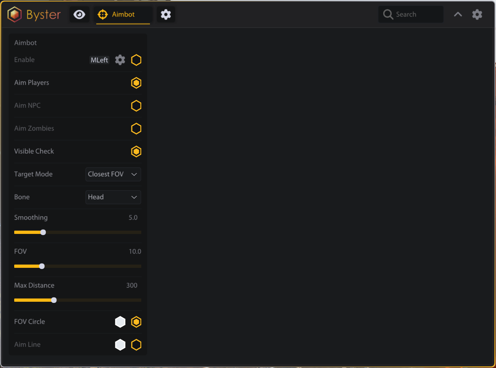
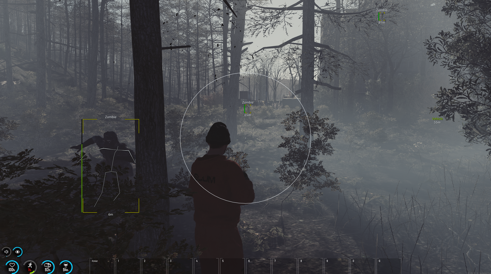

# SCUM

<figure><figcaption></figcaption></figure>

<figure><figcaption></figcaption></figure>

## ESP

### ИГРОКИ

> Включить ESP Имя Полоска здоровья Текст здоровья Дистанция Линия Оружие Скелет Бокс (Выкл/Углы/2D) Проверка видимости Макс. дистанция

### ЗОМБИ

> Включить ESP Имя Полоска здоровья Дистанция Линия Скелет Бокс (Выкл/Углы/2D) Проверка видимости Макс. дистанция

### NPC

> Включить ESP Имя Полоска здоровья Дистанция Линия Скелет Бокс (Выкл/Углы/2D) Макс. дистанция

### ЖИВОТНЫЕ

> Включить ESP Имя Дистанция Линия Макс. дистанция

### ПРЕДМЕТЫ

> Включить ESP Имя Дистанция Макс. дистанция Оружие Патроны Еда Испорченная еда Медикаменты Обвесы Одежда Остальное

### ТРАНСПОРТ

> Включить ESP Имя Дистанция Линия Макс. дистанция

### ТУРЕЛИ

> Включить ESP Имя Дистанция Линия Проверка видимости Макс. дистанция

### РЕЙЗОРЫ

> Включить ESP Имя Дистанция Скелет Макс. дистанция

## АИМБОТ

### АИМБОТ

> Включить (с бинд-клавишей) Аим на игроков Аим на NPC Аим на зомби Проверка видимости Режим цели (FOV/Дистанция/Комбо) Кость (Голова/Грудь/Левая рука/Правая рука/Левая нога/Правая нога) Сглаживание FOV Макс. дистанция Круг FOV Линия прицела

## РАЗНОЕ

### РАЗНОЕ

> Прицел Счётчик FPS FPS оверлея
