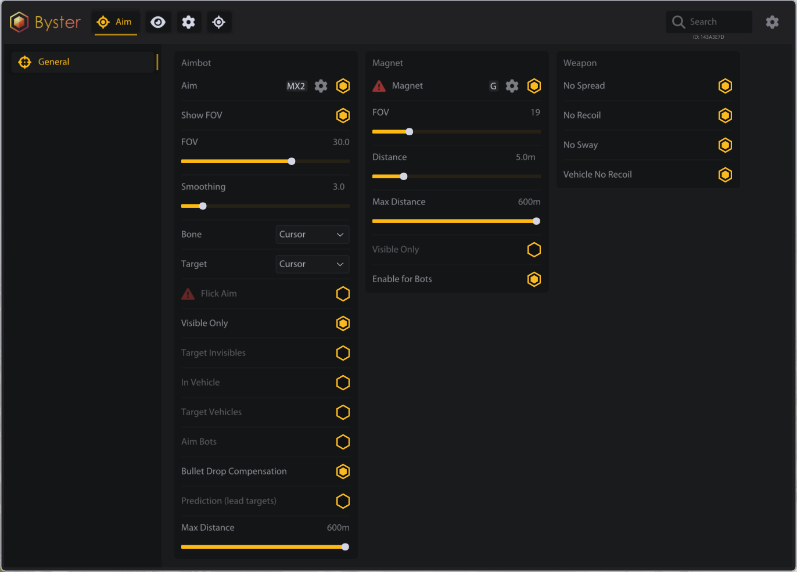

# Squad

<figure><figcaption></figcaption></figure>

<figure><figcaption></figcaption></figure>

### AIM

> Авто-наводка на врага по бинду\
> Отрисовать круг зоны аима\
> FOV\
> Плавность\
> Кость\
> Логика выбора цели\
> Flick Aim\
> Только видимые\
> Целить за стенами\
> Аим в технике\
> Целить по технике\
> Аим по ботам\
> Компенсация падения пули\
> Предиктор\
> Макс. дистанция

### MAGNET

> Притянуть врага к камере\
> FOV\
> Дистанция\
> Макс. дистанция\
> Только видимые\
> Тянуть ботов

### WEAPON MODS

> Без разброса\
> Без отдачи\
> Без покачивания\
> Без отдачи на турели

## ESP

### PLAYER ESP

> Тип бокса\
> Цвет бокса\
> Цвет видимого врага\
> Показывать ботов\
> Никнейм\
> Оружие\
> Дистанция\
> Здоровье (Полоска)\
> Здоровье (Текст)\
> Скелет\
> Линии\
> Кровотечение\
> Направление взгляда\
> Масштаб при ADS\
> Только враги\
> Ники своих сквозь стены\
> Макс. дистанция

### VEHICLE ESP

> Название\
> Дистанция\
> Здоровье\
> Бокс\
> Линии\
> Только враги\
> Скрыть неизвестную команду\
> Макс. дистанция

### DEPLOYABLE ESP

> Включить\
> Название\
> Дистанция\
> Здоровье\
> Фильтр категорий

### RADAR

> Мини-радар\
> Размер / Радиус\
> Позиция на экране\
> Только враги\
> Показывать ботов\
> Показывать технику\
> Направление взгляда\
> Ники на радаре\
> Конус FOV\
> Круглый радар\
> Кольца дальности

## MISC

### MISC

> Свой прицел\
> Стиль прицела\
> FOV Changer\
> HUD патронов\
> HUD K/D\
> Бесконечные патроны\
> Бесконечная стамина\
> Свободная камера\
> Скорость камеры

### EXPLOITS

> Speed Hack\
> Множитель скорости\
> Desync\
> Сила десинка\
> Big Player\
> Множитель размера
