# WARDOGS

<figure>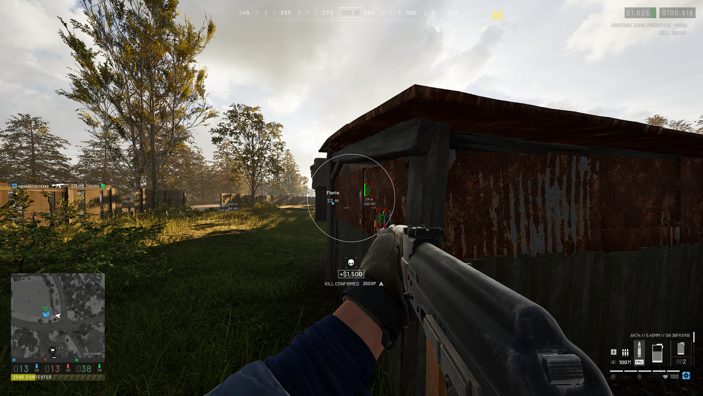<figcaption></figcaption></figure>

<figure>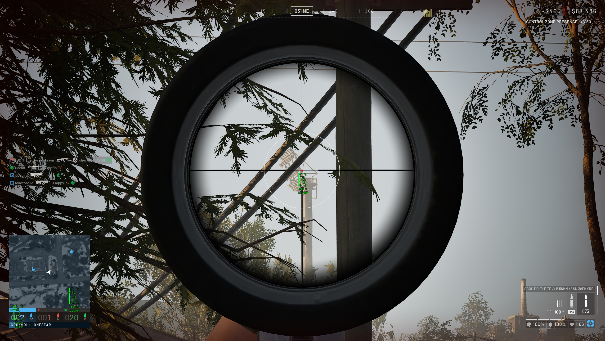<figcaption></figcaption></figure>

<figure>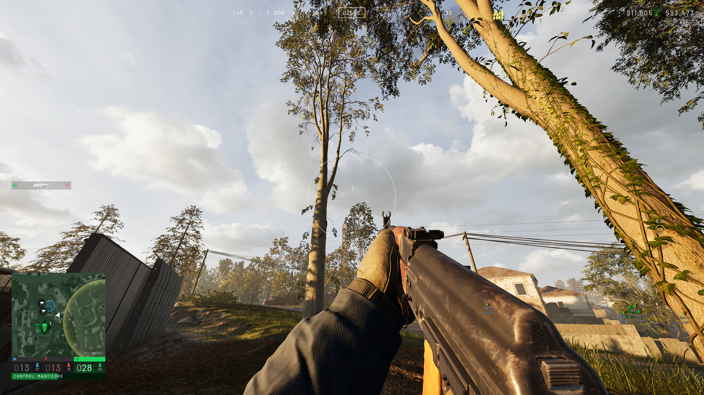<figcaption></figcaption></figure>

<figure>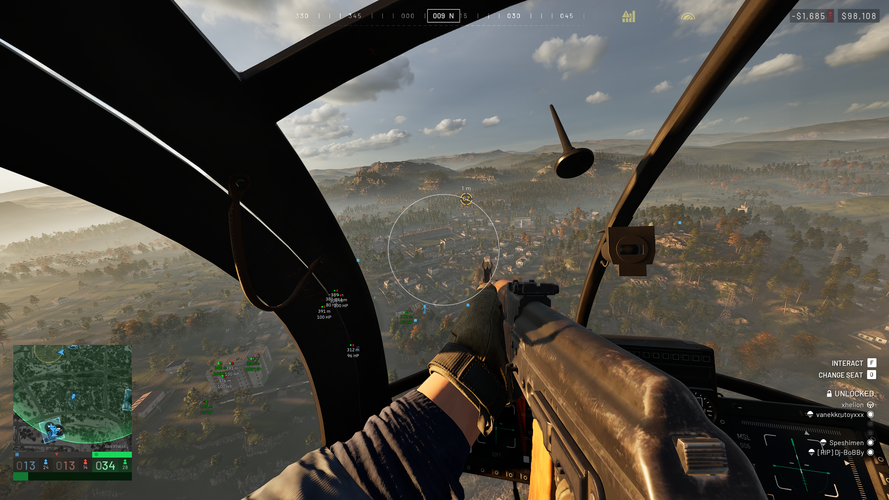<figcaption></figcaption></figure>

<figure>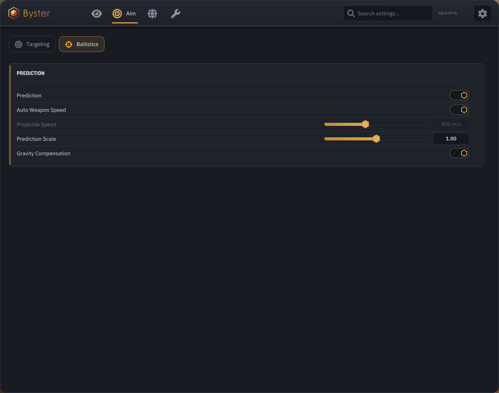<figcaption></figcaption></figure>

<figure>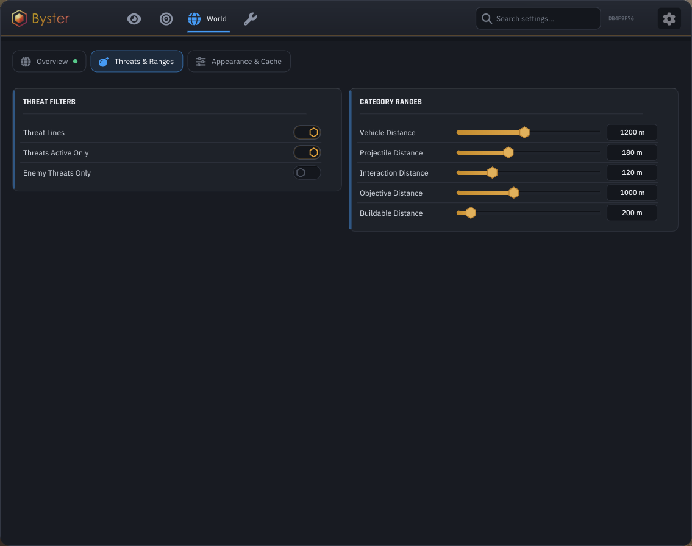<figcaption></figcaption></figure>

<figure>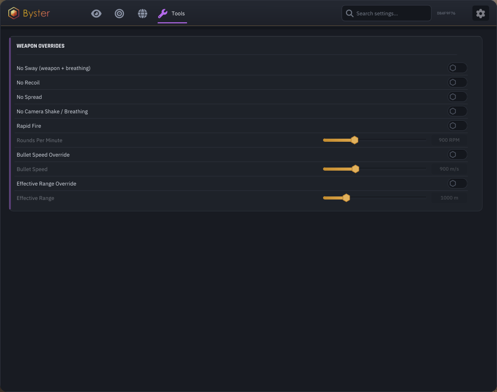<figcaption></figcaption></figure>

<figure>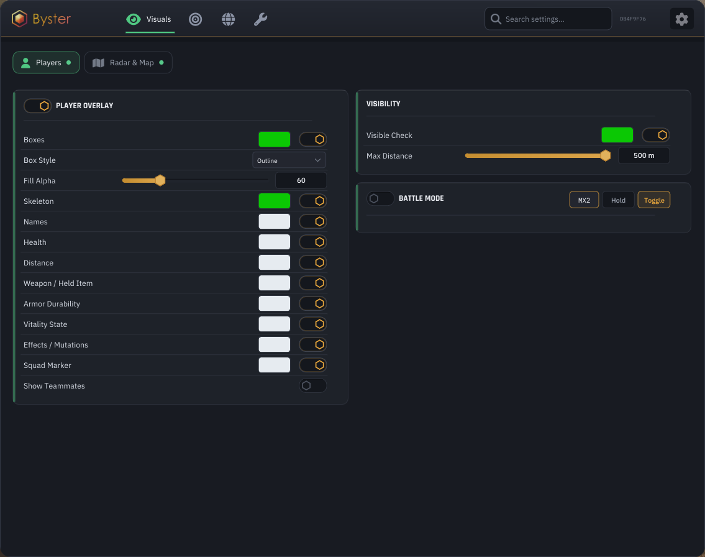<figcaption></figcaption></figure>

<figure>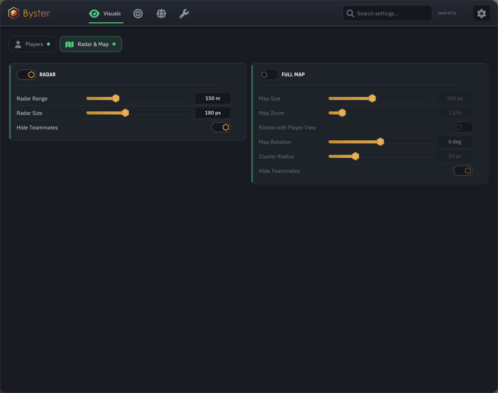<figcaption></figcaption></figure>

<figure>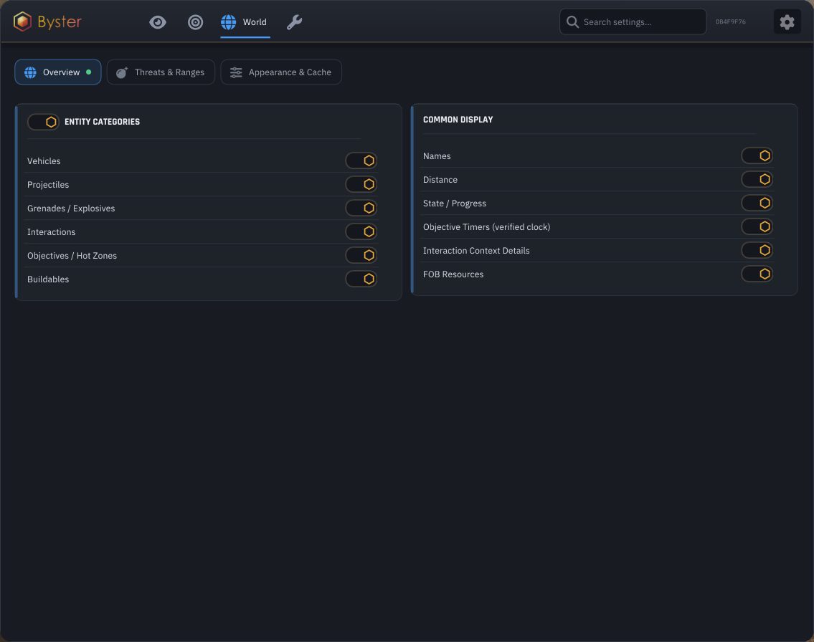<figcaption></figcaption></figure>

<figure>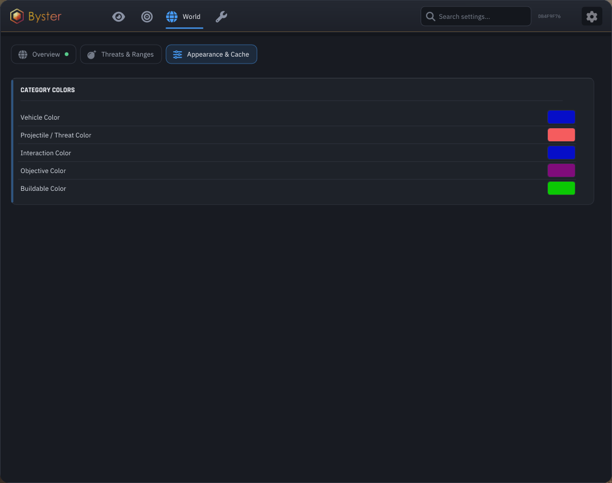<figcaption></figcaption></figure>

## PLAYERS

> Boxes: outline / fill / corners\
> Fill opacity\
> Skeleton\
> Nicknames\
> Health\
> Distance\
> Held weapon\
> Armor durability\
> State: stance, wounded\
> Effects and mutations\
> Squad marker\
> Show teammates\
> Visible Check\
> Max render distance

## RADAR & MAP

> Radar\
> Radar size and range\
> Rotate with player view\
> Hide teammates\
> Full map\
> Map size, zoom and rotation\
> Battle Mode: hide everything except players

## AIMBOT

> Bone selection: head / neck / torso / pelvis\
> Bone priority: nearest to crosshair / random on lock / first selected\
> FOV radius, circle drawing, color\
> Aim smoothing\
> Max distance\
> Aim lock\
> Target switch delay\
> Humanizer and its strength\
> Reaction delay\
> Sensitivity multiplier\
> Target visibility check\
> Shoot through walls: ignore check\
> Targets in vehicles and on turrets\
> Aim at vehicles

## BALLISTICS

> Target movement prediction\
> Auto-detect bullet speed\
> Manual projectile speed\
> Prediction scale\
> Gravity compensation

## WEAPONS

> No Sway: weapon sway and breathing\
> No Recoil\
> No Spread\
> Instant Scope\
> No Camera Shake\
> Rapid Fire and fire rate\
> Bullet Speed Override\
> Effective Range Override\
> Instant Scope

## WORLD

> Vehicles\
> Projectiles\
> Grenades and explosives\
> Interactions and their context\
> Objectives and hot zones\
> Structures\
> FOB resources\
> Names, distance, state\
> Lines to threats\
> Active threats only\
> Enemy threats only\
> Per-category distance\
> Per-category color\
> Objective timers\
> Clustering radius

## LOOT

> Weapons\
> Ammo\
> Armor\
> Backpacks\
> Attachments\
> Medical\
> Scrap\
> Misc
