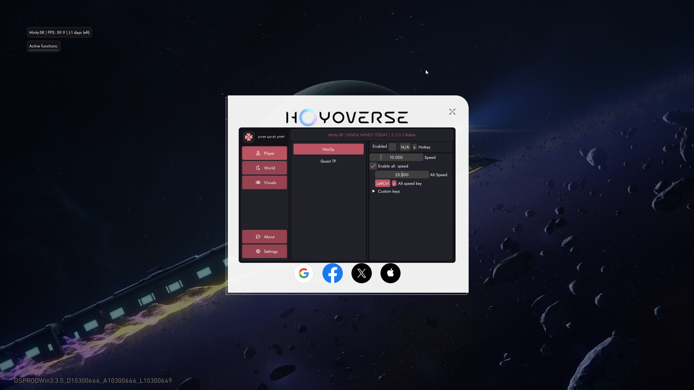

# Как запустить Minty

<figure><figcaption></figcaption></figure>

**МОЙ FUNPAY** - [https://funpay.com/users/4526933/](https://funpay.com/users/4526933/)

**МОЙ FUNPAY** - [https://funpay.com/users/4526933/](https://funpay.com/users/4526933/)

**МОЙ FUNPAY** - [https://funpay.com/users/4526933/](https://funpay.com/users/4526933/)

***

1. Скачайте лаунчер - [ссылка для загрузки](https://loader.kindawindy.today/download)
2. Запустите лаунчер и выберите вашу игру


**Если загрузчик завис на экране загрузки, то откройте загрузчик от имени администратора.**


<figure><figcaption></figcaption></figure>

3. Вставьте ключ и нажмите <mark style="color:purple;">**"Activate"**</mark> для входа. Ниже отобразится количество оставшихся дней подписки.

<figure><figcaption></figcaption></figure>

4. Нажмите <mark style="color:purple;">**"Play"**</mark> чтобы начать загрузку проекта. Дождитесь соответствующего уведомления и <mark style="color:red;">**ВРУЧНУЮ**</mark> откройте игру любым удобным способом.

<figure><figcaption></figcaption></figure>

5. Игра перезагрузится автоматически, и в лаунчере появится сообщение об успешном инжекте.

<figure><figcaption></figcaption></figure>

6. Вот и все, можете спокойно играть! Меню открывается и закрывается на <mark style="color:red;">**"F12"**</mark>

<figure><figcaption></figcaption></figure>

