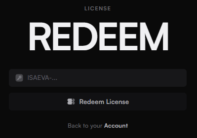

# Как запустить Isaeva

<figure><figcaption></figcaption></figure>

**МОЙ FUNPAY** - [https://funpay.com/users/4526933/](https://funpay.com/users/4526933/)

**МОЙ FUNPAY** - [https://funpay.com/users/4526933/](https://funpay.com/users/4526933/)

**МОЙ FUNPAY** - [https://funpay.com/users/4526933/](https://funpay.com/users/4526933/)

***

## **1. Подготовка системы к запуску продукта:**

1. Отключите **Windows Defender**

<figure><figcaption>
<strong>Выключите защиту в реальном времени</strong>
</figcaption></figure>

2. Окончательно отключите **Windows Defender** с помощью программы dControl

* **Google Drive** - [ссылка для загрузки](https://drive.google.com/file/d/19G3C5Gg1KDr1W05jhwwB6xeMx8PG_IrU/view?usp=sharing) (пароль 1234)
* **Yandex Disk** - [ссылка для загрузки](https://disk.yandex.ru/d/pLPzChHbwskWNQ) (пароль 1234)
* **Mega** - [ссылка для загрузки](https://mega.nz/file/Vr9EUSKB#Sn0bze9l49paasaCZqYPkAodQwo5avSpUWVzo5f4x38)

<figure><figcaption>
<strong>Нажмите "</strong><mark style="color:red;"><strong>Отключить Защитник Windows</strong></mark><strong>" даже если пишется, что он уже выключен</strong>
</figcaption></figure>

3. Полностью удалите (отключение не сработает) любое сторонне антивирусное П.О:                            <mark style="color:red;">**"Kaspersky" / "Avast" / "Avira" / "360 total secure" / "Dr.Web" / "Avast"**</mark>
4. После удаления перезагрузите ПК.

## **2. Запуск продукта:**&#x20;

1. зарегистрируйте аккаунт на сайте исаевы


FunPay запретил давать ссылки на сторонние сайты, поэтому ссылку дать не смогу


* почта
* пароль
* подтверждение пароля

<figure><figcaption></figcaption></figure>

2. Активируйте полученный ключ

<figure><figcaption></figcaption></figure> <figure><figcaption></figcaption></figure>

3. Установите Isaeva

<figure><figcaption></figcaption></figure>

4. Запустите Isaeva и войдите в свой аккаунт который вы ранее создали

<figure><figcaption></figcaption></figure>

5. Запустите Roblox и нажмите Attach

<figure><figcaption></figcaption></figure>

6. Вот и всё готово, для запуска скриптов вставьте скрипт и нажмите Run

<figure><figcaption></figcaption></figure>
